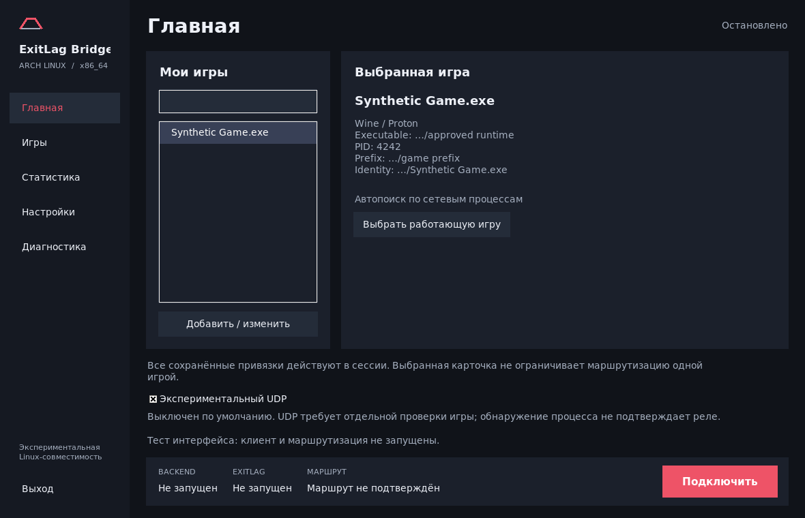
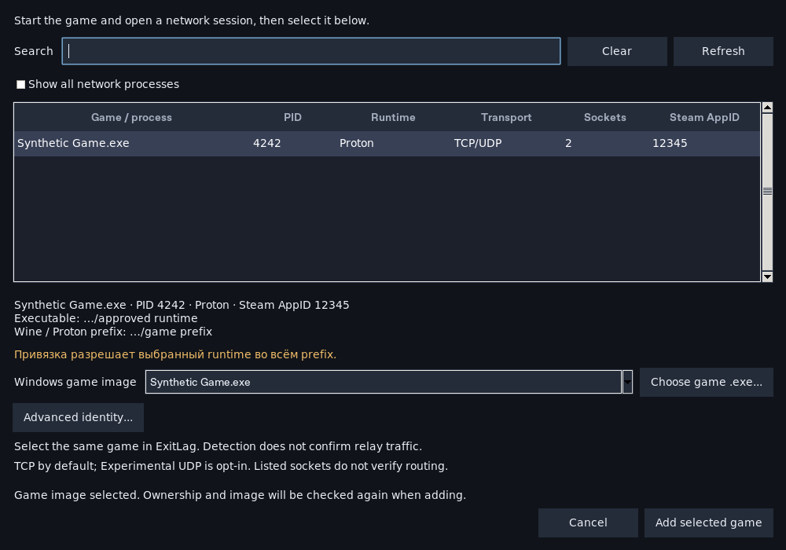

# Итерация desktop UI — Arch Linux

База — `a5a1edb`; основной UI commit — `1f129c9`. Работа продолжает сохранённые
изменения в `main` форка `AlexYT18/ExitLag-bridge`. Область задачи — только
Linux desktop и его упаковка. Network backend, shim, privileged supervisor и
process identity resolver не менялись. Старые пользовательские настройки не
мигрируют и не перезаписываются автоматически.

## Реализация

Вместо двухстраничного launcher создана тёмная широкая ttk оболочка с пятью
постоянными разделами, карточками и нижней connection bar. Основная кнопка
переключается между подключением и остановкой. Есть экран реальных сетевых
процессов с name/PID/AppID search, environment, executable и prefix. Existing
picker используется повторно для проверки/сохранения выбранного process/image.
Добавлено редактирование сохранённых записей без ручных Tab-строк; удаление,
Advanced editor, комментарии и private atomic Save сохранены.

Разделение ответственности:

- `desktop_ui.py` — тема и виджеты, собственная простая графика Bridge.
- `desktop_support.py` — presentation state, path masking, bounded safe log tail
  и read-only diagnostics. Маршрут никогда не подтверждается косвенными признаками.
- `desktop_session.py` — существующие unprivileged Wine operations и environment.
- `app.py` — координация событий Tk, tasks, start/stop и session generations.
- `game_picker.py` — существующий selection/editor и новые warning/edit helpers.
- `build.py` — все новые модули явно включены в пакет `0.4.0+arch.2`.

Долгие setup, process discovery, diagnostics, tasklist/taskkill и ожидание
supervisor выполняются в workers. Результаты применяются UI-потоком. Generation
не даёт старому tasklist ответу остановить новую сессию. Lease отзывается до
stop; неподтверждённая остановка сохраняет handles/lock и не возобновляет lease.
Client log открывается неблокирующе с проверкой типа/owner/permissions: FIFO
не может повесить Tk. Маршрутизация и команды root runner остаются прежними.

## Адаптация референса

Использованы широкая компактная компоновка, постоянная навигация, выбранная
игра, контрастное основное действие, компактные списки и отдельные состояния
подключения. Не использованы официальный logo, изображения, иконки или тексты.
Точного визуального source reference ExitLag v1 в среде не было; идентичность
не заявляется. Framework остаётся Tkinter/ttk, дополнительных runtime
GUI-библиотек нет.

Не добавлены регион/relay selector, каталог официального сервиса, ping/loss/
jitter/traffic charts и измерения, которых GUI не получает. Маршрут подтверждён
не показывается: отдельного авторитетного канала подтверждения нет. Backend
readiness marker не объявляется постоянным health check. Настройка и реальные
route decisions остаются в официальном клиенте. Все saved mappings действуют
для сессии, выбор карточки не меняет scope маршрутизации.

## Проверки существующими командами

На Cloud Debian, системный Python и Tk 8.6.16, отдельный Xvfb:

| Проверка | Итог |
| --- | --- |
| `python3 tests/test_linux_launcher.py` | 32 PASS, 0 FAIL, 0 SKIP |
| `python3 tests/test_game_picker.py` | 35 PASS, 0 FAIL, 0 SKIP |
| `python3 tests/gui-picker-smoke.py` | 16 PASS, 0 FAIL, 0 SKIP |
| `python3 tests/test_linux_packaging.py` | 10 PASS, 0 FAIL, 0 SKIP |
| Portable builder с настоящими existing payloads | PASS, все UI modules включены |
| `test_desktop_ui.py` для собранного дерева в Xvfb | PASS: первый запуск и invalid-installer rejection |

Для Linux launcher проверялись асинхронная остановка, generation stale answers,
failed stop и отсутствие повторного lease, корректные private log targets,
ошибки и redaction. Для picker сохранены проверка owner/image, ambiguity,
private saves и stale process отказ. Tk тесты проверяют пять страниц, реальный
UI heartbeat при медленной операции, name/AppID search, masked card, edit
apply/cancel/Save, clipboard redaction и доступность controls при 1040×680.
Скриншоты ниже получены существующими preview переменными; synthetic fixtures
присутствуют только в тесте, а не в продукте.

Сетевые, privileged и live tests не запускались: пользователь ограничил эту
итерацию существующими UI/build checks. Старые сетевые результаты не выдаются
за повторный прогон. Actual Arch desktop, Wayland/DPI, настоящий ExitLag и
реальная game/relay session этой итерацией не подтверждены.

### Найденные FAIL и исправления

Первый Tk прогон: 13 PASS / 2 FAIL из 15. Fixture нового dashboard не запускала
доставку TaskQueue callbacks; добавлен Tk-side delivery loop. Второй FAIL был
реальным layout defect: footer кнопка не помещалась после смены шрифта.
Footer и details теперь резервируют место снизу, таблица занимает остаток.
Status/error label и image selector остаются видимыми. Последующие 16 cases PASS.

Логические проверки Cloud custom Tk 9.0.4 также проходят, но его сборка без Xft
видит только bitmap fonts: кириллица на screenshot не отображалась. Такой
скриншот не публикуется. System Tk 8.6 видит Unicode fonts; preview переснят и
осмотрен. Capture проверяет наличие DejaVu Sans, чтобы не сохранить заведомо
некорректное изображение. Encoding workarounds в продукт не добавлены.

При review найден и закрыт privacy defect bounded tail: многострочный секрет
мог лишиться ключа за пределами окна чтения. Начало обрезанного tail теперь
отбрасывается до полной blank-line record boundary; regression case PASS.
Добавлены типичные API/access/private-key masks. Masking консервативен и не
даёт гарантии безопасности публикации произвольных raw logs.

## Скриншоты и инструкция

[Пользовательская инструкция](../desktop-ui.md) описывает статусы, scope mappings,
UDP opt-in, приватность, сборку и ограничения. [Сборка на Arch](../arch-linux.md).
Коммиты и artifacts сохраняют экспериментальный статус; runtime service/game
compatibility не заявляется.
