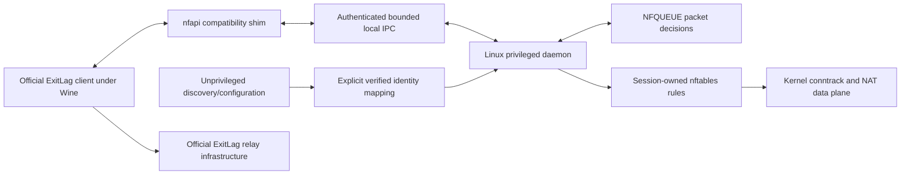

# Initial source audit

Baseline: `c0525a74c35fd74c815326d957c21a593a6aaccb` (public `main`). Audit started 2026-11-01 UTC. This is a development audit, not a penetration-test certificate, live routing report, or stable-release declaration. The initial working tree was intentionally uncommitted; publication commits were authorized later.

## Scope and evidence

All **185 tracked files** were inventoried from committed blobs and assigned for review before architectural changes. First-party source, scripts, tests, workflows and technical documents were read; binary site assets were classified by metadata. [FILE_INVENTORY.md](FILE_INVENTORY.md) records every path, purpose, size and SHA256. Third-party notices were preserved; no vendor client or account material was downloaded into the source tree.

Detailed evidence uses **baseline line numbers**; subsequent fixes move those lines. Each subsystem report separates source-confirmed behavior from hypotheses and identifies dependencies, missing tests, concurrency/performance risks and refactoring opportunities:

| Subsystem | Detailed report |
| --- | --- |
| Native daemon, nftables, runners, packed IPC | [BACKEND.md](notes/BACKEND.md) |
| PE shim, ABI, Wine WMI patch | [SHIM.md](notes/SHIM.md) |
| Game/socket discovery, mapping, setup/launch/version tools | [DISCOVERY_TOOLS.md](notes/DISCOVERY_TOOLS.md) |
| Shared/Linux installers and preserved macOS implementation | [INSTALLERS_MACOS.md](notes/INSTALLERS_MACOS.md) |
| Every test fixture/harness and GitHub workflow | [TESTS_CI.md](notes/TESTS_CI.md) |
| Documentation, site, metadata, notices and historical claims | [DOCUMENTATION_LICENSING.md](notes/DOCUMENTATION_LICENSING.md) |

## Architecture assessment

The existing separation is useful: the official client supplies proprietary routing decisions through an x64 Wine DLL, while a Linux process handles NFQUEUE, attribution and exact-tuple nftables NAT. Keep this design and its legitimate authentication/subscription requirements. There is no evidence justifying a language rewrite or eBPF dependency.

The implementation remains experimental. The daemon combines IPC, procfs attribution, packet parsing, callback transactions, UDP state and firewall mutation in one synchronous loop. A stalled callback delays packet verdicts. The PE shim duplicates wire definitions and has global callback/lifecycle state. Privileged setup and cleanup are spread across launchers. Tests cover some important negatives, but several bypass the current protocol or overstate what was executed.

The diagram describes responsibilities, not verified support for arbitrary games. Official relay behavior is outside this repository's control. Detection, inspection, callback mutation, applied routing, relay bytes and stable gameplay require separate evidence.

## Prioritized confirmed findings

Severity is scoped to this experimental deployment. A source-confirmed weakness is not automatically a reproduced hostile exploit or observed wrong-game redirection. Remediation status belongs in [ITERATION_REPORT.md](ITERATION_REPORT.md), so this initial record remains an honest baseline.

| ID | Severity | Confirmed finding and affected code | Recommended change |
| --- | --- | --- | --- |
| B01 | High availability | Blocking writes and per-fragment/per-frame timeout renewal can indefinitely occupy the only packet loop (`backend/exitlag-netd.c:547-575,1079-1136`) | Absolute monotonic transaction deadlines; nonblocking I/O; hostile-peer tests |
| B02/B03 | Medium security | Candidate connection evicts the active shim before token validation; reserved flags and repeated HELLO not enforced (`:1195-1250`) | Authenticate before replacement, central framing checks, explicit session transitions |
| B04/D1 | High attribution | Strict maps compare arbitrary argv against even native source paths (`:831-856`); negative test supplies the wrong spoof target | Match native `/proc/PID/exe` only; adversarial source/argv0 cases |
| B04/D2 | High attribution | Prefix mapping accepts `WINEPREFIX` from any executable (`:801-828`) | Bind prefix to explicitly configured canonical owner executable; fail closed on legacy ambiguous rows; document remaining image-proof limitations |
| B05/SHIM-05 | High before broad deployment | TCP attribution ignores remote tuple; UDP wildcard/shared-port attribution is ambiguous | Full socket identity, owner generation/UID/namespace; reject ambiguity before broad interception |
| B06/SHIM-07 | High before broad UDP | UDP tuple reuse and shim reconnect retain stale endpoint state; PID rings lack birth identity | Socket-generation keys, reconnect replay/reset, bounded lifecycle tests |
| SHIM-01 | High reliability | `nf_free` does not close/join IPC workers; reinit can create concurrent workers | Explicit start/stop/join state machine tested with Wine callback provider |
| SHIM-03 | High memory safety | PID reply path length not bounded by received bytes (`shim/nfapi/nfapi_stub.cpp:1365-1373`) | Exact wire/body/output bounds before copying, malformed reply tests |
| B10 | High confidentiality | Default UDP diagnostics log payload prefixes; root log opening follows links (`backend/exitlag-netd.c:992-1019,1585-1650,2080`) | Metadata-only defaults and secure file opening; never package runtime captures |
| SHIM-02 | Medium | Endpoint parser accepts remote IP, overflowed octets and trailing garbage (`nfapi_stub.cpp:1813-1832`) | Strict numeric loopback parser, bounded arithmetic and port validation |
| SHIM-04/06 | Medium | Shim body cap differs from protocol; duplicated records and unchecked flags | Shared freestanding wire header, compile-time size assertions and boundary tests |
| B07/B08 | Medium | Second-resolution endpoint seed repeats on fast restart; NFQUEUE readiness logged before ACK | Session generation; acknowledged configuration before ready |
| B09/B12 | Medium security/lifecycle | Inconsistent runner lock/cleanup, fixed-name table ownership, weak nft input validation and UDP scope | One owned session lifecycle; typed scope parsing; isolated crash/cleanup tests |
| B11 | Medium packet correctness | IPv6 extension chains unsupported; UDP truncation clamped instead of rejected for active use | Independently tested bounded packet parser; fail open on unsupported forms |
| INSTALLERS-01/02/03 | Medium reliability | UTF-16 `tasklist` treated as inactive; taskkill timeout aborts cleanup; future lease timestamp prolongs helper | Normalize output, bounded stop fallback, validate lease age |
| INSTALLERS-04 | Medium availability | Privileged macOS config read can block on FIFO before checking type | Nonblocking no-follow file open, owner/type/link checks and FIFO test |
| TESTS-01/02 | High validation impact | Old v2 TCP/UDP synthetic clients cannot authenticate to v3; SKIP returned as success; unknown tier passes empty suite | Current protocol fixtures, exit77 semantics, explicit test result records |
| TESTS-03/04 | High test isolation impact | Global `pkill`, host netfilter access, external probes in system tests; no-queue fuzz calls firewall teardown | Disposable PID/mount/network namespaces; owned processes and local fixtures |
| DOC-01..11 | Medium evidence quality | Contradictory loopback/IPv6 claims, stale counts, universal fail-open/vendor-blame prose | Bound statements to inspected code or reproducible, dated results |

The detailed reports contain additional findings, exact evidence, reproduction notes and limitations. No finding authorizes anti-cheat, license, account or subscription bypass.

## Confirmed technical limits

- TCP IPv4/IPv6 same-family exact-tuple DNAT exists. There is no complete native TCP established/closed state manager; conntrack owns the data flow. Extension-header and ambiguous-attribution cases are not universal support.
- UDP has bounded endpoint/rule registries and lifecycle/inspection callbacks. Active mode is deliberately limited to a selected IPv4 endpoint and unchanged datagrams with narrowly validated posts. It is **not general relay transport**, nor verified multi-game, multi-endpoint or IPv6 reinjection support.
- Native/Steam/Wine/Proton discovery provides candidate evidence. Launcher ancestry and a recognizable filename alone do not establish the process owning the game's sockets or the Windows identity expected by ExitLag.
- Export-name coverage cannot prove reconstructed C++ ABI layout or callback semantics. Wine 11.17 WMI packaging is pinned and layout-specific. Client and Wine updates require validation.
- There is no measured universal NetworkManager, systemd-resolved, VPN or anti-cheat coexistence guarantee. Games unsupported on Linux remain unsupported independently of this bridge.
- No new game, relay connection, subscription or live gameplay was tested by this audit. Historical reports in existing documents are not rerun evidence.

## Baseline and next steps

The initial restricted sandbox lacked headers/LLVM and denied local sockets; its existing aggregate suite returned **1 PASS / 8 FAIL / 7 SKIP**. After dependency preparation and the user's full-access change, a clean baseline snapshot returned **5 PASS / 4 FAIL / 7 SKIP**: two LLVM path-parsing failures and two copied-Python fixture failures. Neither result is hidden or presented as a successful regression suite. See [BASELINE_TESTING.md](BASELINE_TESTING.md) for commands, environment transitions and later results.

Proceed incrementally according to [ROADMAP.md](ROADMAP.md): close provable IPC/identity/parser/test-harness defects first; preserve behavior with cloud-safe regressions; run isolated kernel tests when available; defer broad UDP and compatibility claims until adequate lifecycle and live evidence exist.
