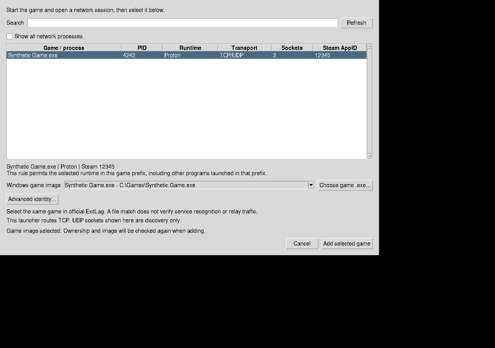

# Итерация: выбор работающей игры вместо ручных Linux-путей

База: `c136b3323e0923d44de547e3470a3f3f73605e2a`.
Цель — Arch Linux x86_64, ветка `arch-linux-hardening` пользовательского форка.
Тест PEAK на компьютере пользователя отложен по его просьбе. Его скриншоты
показали проблему настройки; они не являются результатом routing/gameplay.

## Проблема и результат

Редактор требовал вручную находить executable, Proton prefix, loader и вводить
Tab-separated строки. Выбор файла игры сам по себе не определяет владельца
сокетов, а общий wineserver может показываться рядом с процессом игры.

Основной редактор заменён списком настроенных игр. **Add running game...**
открывает поиск и список сетевых процессов текущего пользователя с PID,
runtime, TCP/UDP, количеством сокетов и доступным Steam AppID. Служебные
процессы по умолчанию скрыты; есть Refresh и Show all network processes.

Для Wine/Proton фактические prefix и loader захватываются автоматически.
Windows image выбирается из реальных PE-файлов, отображённых выбранным
процессом. При одном варианте он подставляется; при нескольких требуется
выбор. Если нужный image не виден, можно выбрать настоящий `.exe` в file picker;
Windows-путь строится из проверенных drive mappings prefix. Обычному сценарию
не нужен ручной ввод Linux-путей. Native Windows identity без надёжных данных
остаётся явной настройкой в Advanced.

**Advanced...** сохраняет прежний текстовый формат, file pickers, комментарии
и старые строки. Двухколоночные prefix rows не дополняются выдуманным loader;
они помечены Needs review и требуют повторного добавления или явного исправления.

## Изменения кода и границы

| Файлы | Назначение |
| --- | --- |
| `installers/bridge_setup/process_picker.py` | Unprivileged bounded scanner, snapshots, PE candidates, Wine path translation и revalidation |
| `installers/linux/game_picker.py` | Controller, private atomic settings I/O, background task queue и Tk dialogs |
| `installers/linux/app.py` | Подключение нового editor; lifecycle коммерческого клиента не переписан |
| `installers/linux/build.py` | Новые GUI/discovery dependencies в пакете; `--portable-only` для Arch без dpkg |
| `tests/test_process_picker.py`, `tests/test_game_picker.py` | Policy, malformed/race/cleanup tests и headless controller tests |
| `tests/gui-picker-smoke.py` | Настоящие Tk widgets в отдельном Xvfb, synthetic process provider |
| `tests/test_linux_packaging.py` | Контролируемая fixture упаковки, права и metadata; без proprietary payloads |
| `tests/cloud_checks.py`, `tests/run-all.sh`, Arch workflow | Регистрация новых тестов и Xvfb в CI |

Привилегированный backend, nft rules, shim ABI и IPC protocol не изменены.
Модель повторно использует форматирование/classification существующего
discovery tool; ограниченное чтение `/proc` выделено отдельно, чтобы не
передавать GUI полный env/argv. Поздняя унификация CLI scanner остаётся
возможным refactoring, а не поводом ослабить новые проверки.

Во время fixture packaging обнаружены неверные права каталогов при `umask 077`:
dpkg отвергал DEBIAN 0700, а program root мог быть недоступен обычному пользователю.
Права контролируемых staging/program directories, installer scripts и desktop
entry теперь задаются явно; исходный default Debian build сохранён.

## Проверки

- **39 model unittest methods PASS**, включая настоящие собственные TCP/UDP
  sockets без root. Проверяются PID reuse/exit, UID/exe/prefix changes, fd close,
  mapped inode/device, подмена image, malformed PE, drive remapping, control
  characters, symlink loops, ограничения размеров и отсутствие доверия argv.
- **26 editor unittest methods PASS**: сохранность строк/комментариев,
  duplicates, private files, symlink/hardlink/FIFO, concurrent edits, отказ
  validator, late results, bounded workers и thread ownership.
- **6 actual Tk tests PASS**: выбор и сохранение, несколько images, native
  explicit identity, stale process, медленный scan/закрытие и смена image во
  время старой file inspection. Проверяется видимость настоящего окна.
- **8 packaging unittest methods PASS** локально, включая настоящий fixture
  dpkg-deb без root. В Arch отсутствие dpkg даёт явный internal SKIP этому
  одному compatibility check; portable checks не требуют Debian tools.
- Общий L1: **52 групп PASS, 0 FAIL, 2 SKIP**, включая native/PE builds,
  ASan/UBSan, статанализ и mock IPC. Два SKIP — отдельные L2 и live L3.
- L2 regression: **7 групп PASS, 0 FAIL, 1 SKIP**. Не выполнен отдельный
  multi-UID IPC negative suite: single-UID namespace Cloud не предоставляет
  sudo и несколько mapped UID. Остальные registered system tests выполнены.

Evidence: [L1 JSON](evidence/process-picker-cloud.json),
[L1 summary](evidence/process-picker-cloud.txt),
[model](evidence/process-picker-model.txt),
[editor](evidence/process-picker-editor.txt),
[Tk](evidence/process-picker-tk.txt),
[packaging](evidence/process-picker-packaging.txt),
[L2 regression](evidence/process-picker-isolated.txt).
GitHub Arch CI проверяется после push отдельно.

Пример настоящего окна ниже использует **синтетические** имя, PID, AppID и
Windows image; он не изображает обнаружение настоящей игры.



```sh
python3 tests/test_process_picker.py
python3 tests/test_game_picker.py
python3 tests/test_linux_packaging.py
python3 tests/gui-picker-smoke.py
bash tests/run-cloud.sh --sanitizers
bash tests/run-isolated.sh
```

Xvfb — test-only dependency; при его отсутствии отдельный Tk test даёт SKIP 77.
Остальные controller/model tests запускаются без display. На Cloud Xvfb и nft
распакованы в workspace prefix; это не меняет общую сеть или аккаунт пользователя.

## Security review и остаточные ограничения

1. Имена, AppID и env hints не являются identity proof. Разрешение основано на
   same-UID/starttime/kernel executable, held socket и observed prefix. Перед
   добавлением данные перепроверяются; процесс может измениться после проверки,
   поэтому atomic attestation не заявляется.
2. PE candidate проверяет реальные bytes/header, maps device/inode и Wine drive
   mapping. Это не доказательство recognition в закрытом каталоге ExitLag и не
   подтверждение proprietary callback semantics. Значение identity не выдумывается.
3. Привязка остаётся prefix-wide для выбранного loader, а не постоянной
   авторизацией одного PID или Windows image. Это явно указано в диалоге.
   Изолированные game prefixes предпочтительнее общего prefix.
4. Чтение ограничено по размерам и количеству. Общий wall-clock deadline для
   filesystem I/O не реализован; медленный диск может задержать worker.
   Tk остаётся отзывчивым, jobs ограничены, late callbacks после закрытия
   игнорируются. Это не принудительное прерывание зависшего syscall.
5. Flatpak/container paths, недоступный `/proc`, отсутствие настоящего
   WINEPREFIX или unresolvable drive mappings требуют явной настройки;
   префикс не угадывается только по Steam environment hint.
6. Desktop launcher по-прежнему маршрутизирует TCP. UDP здесь показывается
   для discovery. Общий UDP backend, conntrack lifecycle, shared-fd attribution
   и shim worker stop/join остаются открытыми.
7. L3, PEAK, коммерческий клиент, настоящие реле и gameplay — **NOT TESTED**.
   Данные аккаунта не использовались; performance improvement не заявляется.

Новый GUI включён в source package layout. Полный installable runtime archive
с Wine payloads в этой итерации не собирался: `installers/payloads` отсутствует.
Fixture archives не являются поставляемыми пакетами и не публикуются как рабочие.
Старый установленный upstream installer не обновляется от одного `git pull`.
См. [инструкцию выбора игры](../game-selection.md) и build instructions.

Следующая работа: проверить новый picker на живом Arch/Proton, затем продолжить
cached conntrack tuple reuse, lifecycle и общий UDP по roadmap. Полная игровая
совместимость требует фактических relay/gameplay evidence.
