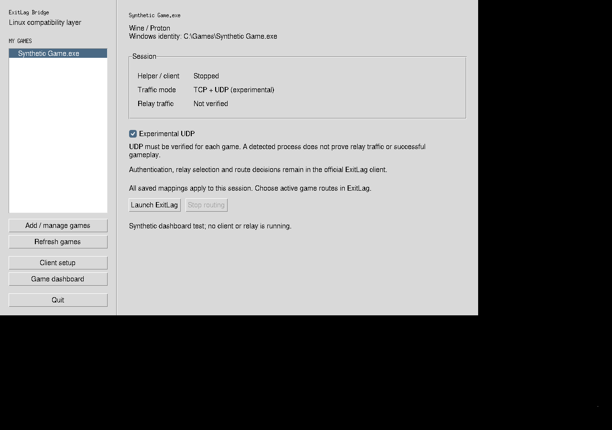

# Итерация: multi-endpoint UDP и минимальный desktop dashboard

База UDP foundation — `6717c61b7841e57ee4ece328ce2b7af2144819be`;
целевой продукт — Arch Linux x86_64. Существующие single-endpoint UDP
experiments сохранены. Новая функциональность остаётся экспериментальной;
тесты используют явно обозначенный синтетический callback provider.

## Исследованные проблемы и изменения

| Проблема | Изменение | Затронутый код |
| --- | --- | --- |
| Cache по local address/port мог пережить socket и сообщить PID предыдущего владельца | Свежий tuple→inode lookup; generation/UID/held-fd checks и session-bound endpoint state | `backend/exitlag-netd.c`, ранее выделенные `udp_attribution` и `process_identity` |
| Один вручную выбранный endpoint и узкий unchanged IPv4 contract | Явный `--udp-multi`; IPv4/IPv6 POST_SEND target/payload и POST_RECEIVE source/payload application | `backend/exitlag-netd.c`, `nft-setup.sh`, `udp_packet`, `udp_peers`, `nfq_verdict` |
| Connected UDP не принимает relay source вместо исходного peer | Ограниченный reverse binding, fresh owner proof и full-packet NFQUEUE replacement | `backend/exitlag-netd.c` |
| Разные connected sockets с общим local port могли слиться в один relay tuple | Отказ до DROP/raw send при конфликтующем owner или reverse binding | `backend/exitlag-netd.c` |
| Summary reply мог не соответствовать действительному SDK post | Exact framing, tag/endpoint/session/direction correlation, ровно один действительный post | Native daemon; `shim/nfapi/udp_validation.h`, `nfapi_stub.cpp` |
| Глобальные callback context/receive buffers могли смешиваться между workers | Windows TLS context и private receive/owner-table buffers; fresh UDP owner lookup | `nfapi_stub.cpp`, `socket_attribution.h`, `kernel32.def` |
| Unsupported lifecycle controls могли перестать блокировать доставку на следующем packet | Persistent endpoint refusal до удаления endpoint или новой authenticated session | `backend/exitlag-netd.c` |
| Вложенный RPC мог потребить PONG, уже отмеченный внешним poll | Повторная неблокирующая readiness check и проверка session generation перед unsolicited read | `ipc_transport.{c,h}`, main daemon reactor |
| UDP не был доступен из защищённого installed launcher | Фиксированный UDP runner, явный supervisor `--udp`, sanitized environment и прежний lease/cleanup | `run-udp-multi.sh`, `installers/linux/run_root.py`, `build.py` |
| Настройка не показывала удобную сводку сессии | Sidebar сохранённых игр, детали, Launch/Stop routing и UDP opt-in; relay status остаётся Not verified | `installers/linux/app.py` |

## Проверки с фактическим результатом

### Итоговый L1

**61 группа PASS / 0 FAIL / 2 SKIP**, exit 0, для кода `83cbf7d`.
[JSON](evidence/udp-final-cloud.json), [сводка](evidence/udp-final-cloud.txt).
Включены native и PE builds, actual Tk, mock IPC/security negatives,
GCC analyzer/Cppcheck, ShellCheck и ASan/UBSan. Два SKIP — отдельный L2
runner и live L3; L2 выполнен отдельно ниже. Обычная release-сборка helper
восстановлена. Новые игры, runtime Wine ABI и performance этим не подтверждены.

### L2: 63 synthetic UDP probes PASS

В Cloud выполнены user/network/PID/mount namespaces с локальными IPv4/IPv6
veth peers; host firewall не изменялся. Helper — настоящая native сборка с
NFQUEUE и raw sockets. Вместо официального клиента отвечает локальный
authenticated synthetic provider. Он задаёт известные mutations для проверки
packet path; эти ответы не выдаются за решения сервиса ExitLag.

Проверены:

- Отсутствующий helper и отсутствие authenticated shim — original traffic.
- Одновременные sockets разных процессов с проверкой callback PID.
- Несколько endpoints, connected/unconnected sockets, разные source ports,
  dynamic remote ports и два outstanding remotes одного unconnected socket.
- Реальные bytes на отдельном synthetic relay, изменения destination и
  payload, обратное декодирование и исходный application-visible source.
- Обычные UDP sockets на `127.0.0.1` и `::1`: loopback proxies получают
  изменённые bytes и отвечают через обычный `sendto`; connected приложение
  получает восстановленный source и ожидаемый payload. Raw-crafted replies
  и ослабление checksum checks для этих tests не использовались.
- Zero-length send/receive, wrong tag/endpoint/family/direction, duplicate
  posts, unsupported options/status, zero destination port и bad receive.
- Shared-local cross-process relay collision: второй flow остаётся direct,
  первый продолжает работать; immediate port reuse получает свежий PID/ID.
- Timeout, fresh authenticated session, persistent flow-control refusal и
  восстановление только после сброса session.
- Детерминированная гонка readable NFQUEUE + PONG: nested RPC не приводит
  к ложному disconnect после обработки packet.
- Nonzero original fwmark: direct bytes, отсутствие UDP callbacks/raw posts
  и сохранение mark после очереди. Отдельные kernel counters подтверждают
  полное 32-bit SO_PRIORITY `0x00020004` на raw replacement для обеих семей.
- Удаление принадлежащих harness процессов, sockets, nft table, veth и netns.

Evidence: [63 probes](evidence/udp-multi-l2.txt). Эти probes не подменяют
общий regression suite. Полный L2 прогон: **8 групп PASS / 0 FAIL / 1 SKIP**
([сводка](evidence/udp-integration-isolated.txt)). Пропущен multi-UID IPC suite:
single-UID Cloud namespace не имеет sudo и нескольких mapped UID. Выполнены
hostile IPC, lifecycle/crash cleanup, IPv6 TCP, TCP redirect/authorization,
legacy UDP observe/steer и новый multi-endpoint UDP.

Дата проверки — 2026-11-04. Host — Debian 13 userspace, kernel 6.18.57,
UID 1000, GCC 14.2, LLVM 19.1.7, nftables 1.1.3; target остаётся Arch Linux
x86_64. [Environment](evidence/udp-environment.txt). CAP_NET_ADMIN на host
не использовалась; kernel tests работают в собственных user/network/PID/mount
namespaces. Для распакованного trusted nft применён compile-time EXL_NFT_PATH;
обычная release-сборка восстанавливается финальным L1 runner. Arch CI
запускается отдельно, Debian host нельзя выдавать за реальный Arch desktop.

### Native/shim/desktop targeted checks

- UDP foundation normal + ASan/UBSan suites: attribution 73 cases,
  packet codec 1 418 077 assertions, peer lifecycle и NFQUEUE encoding — PASS
  в [отдельном checkpoint](UDP_FOUNDATION_CHECKPOINT.md).
- Shim socket attribution/UDP validation — **1100 assertions PASS**;
  existing IPC checks и PE build также выполнены. PE build не подтверждает
  runtime TLS API и callback lifecycle под Wine.
- Installed supervisor — **16 unittest methods PASS**; package fixtures —
  **8 methods PASS**. Это проверки безопасного выбора runner/environment и
  controlled fixtures; фактическая установка нового пакета не выполнялась.
- Actual Tk/Xvfb — **8 tests PASS**, включая новый dashboard/UDP opt-in.
  Synthetic process provider не означает обнаружение настоящей игры.
  [Tk log](evidence/udp-dashboard-tk.txt),
  [supervisor](evidence/udp-supervisor-final.txt),
  [packaging](evidence/udp-packaging-final.txt),
  [launcher](evidence/udp-launcher-final.txt).
- После исправления private owner-table buffers повторены PE build,
  native tests и ASan/UBSan; все **18 exports/ordinals сохранены**.
  [Native](evidence/udp-shim-worker-table-native.txt),
  [PE](evidence/udp-shim-worker-table-build.txt),
  [exports](evidence/udp-shim-worker-table-exports.txt).

Assertions, unittest methods, synthetic probes и aggregate command groups —
разные единицы; их нельзя складывать в число «совместимых игр».

### Найденные FAIL и исправления

Baseline reproduction старого cache подтвердил ошибку: после socket close и
повторного bind другим процессом callback продолжал сообщать первый PID и тот
же endpoint ID. [Baseline](evidence/udp-reuse-baseline.txt). Новый integration
test проверяет именно смену владельца, а не только успешный echo.

Первый extended UDP run выявил stale poll notification: nested callback RPC
уже вычитал pending PONG, затем main loop пытался читать его повторно и
разрывал session по timeout. Native readiness/session fix проверен socketpair
unit test и воспроизводимым isolated race test. Первоначальный FAIL сохранён
в [исходном FAIL](evidence/udp-multi-l2-first-failed.txt).

Одна первоначальная версия race harness требовала чтения
`/proc/net/netfilter/nfnetlink_queue`, недоступного в single-UID namespace.
Harness заменил этот observer на собственный child send acknowledgement;
доступ к host namespace и sandbox restrictions не обходились. Исходный
результат [сохранён](evidence/udp-multi-l2-proc-observer-unavailable.txt).

Первый общий L1 run дал 60 PASS / 1 FAIL / 2 SKIP: старый privacy test ожидал
metadata accepted post, хотя его fixture отправляет post вне callback. Новый
contract явно отвергает такой post; тест теперь проверяет отказ, отсутствие
accepted-post diagnostics и отсутствие payload в logs. Assertions о секретах
сохранены, последующий IPC suite из 16 methods прошёл.
[Исходная сводка](evidence/udp-cloud-initial-failed.txt),
[исправленный IPC test](evidence/udp-ipc-regression-corrected.txt).

Первый общий L2 run дал 6 PASS / 2 FAIL / 1 SKIP: старые observe/steer tests
прошли проверку bytes и callback sequence, но выявили утраченные diagnostic
names и cleanup counters. Восстановлены прежние API names, observation status
и `remote_rules_deleted` с datagram counters. Ожидания legacy tests не ослаблены.
[Первоначальный L2 FAIL](evidence/udp-integration-isolated-initial-failed.txt).

### Пример интерфейса

Окно использует synthetic game identity и остановленную сессию. Это настоящий
Tk screenshot теста, без клиента, аккаунта или игрового routing result.



## Security review

Базовые authenticated IPC, token/UID checks, private mappings/logs и
runtime ownership guard сохранены. Новый installed runner требует явный
authorized UID и identity map, использует фиксированные paths и отдельное
разрешение UDP remote targets. Root не исполняет map как shell input.

Активное изменение допускается только после owner revalidation и валидного
синхронного post. Endpoint/peer capacity ограничены; slot резервируется до
send и commit делается после успеха. Unsupported packet/callback shapes,
ambiguity, capacity exhaustion и исходный nonzero fwmark оставляют original
packet без изменения. Metadata logs не содержат datagram payloads или
account credentials. Synthetically generated test payloads — отдельные fixtures.

Остаточные риски и не завершённые задачи:

1. `/proc`/fd/identity validation не атомарна с отправкой packet; shared fd
   и same-UID exec/prefix races требуют дальнейшего исследования. Prefix
   scope не равен доказанному Windows executable identity.
2. Полный stop/join shim workers при `nf_free` не реализован. TLS/session
   checks ограничивают post authority, но старый worker ещё может мешать
   reconnect/availability. Wine runtime stress test остаётся необходимым.
3. UDP поддерживает synchronous posts. Asynchronous SDK delivery, arbitrary
   options/controls и применение `udpConnectRequest` remote mutation вне
   datagram post не реализованы.
4. Scoped/mapped IPv6 wire addresses, fragments/options/extensions/GSO и
   jumbograms не поддерживаются. IPv4 lookup IPv6 ANY bind может безопасно
   отказаться от обработки даже при фактически подходящем socket.
5. Raw mark `0x584c0001` зарезервирован для bypass; raw socket helper имеет
   собственный UID routing context. Nonzero original fwmark оставляется
   direct. Совместимость с VPN/policy routing/NetworkManager конфигурациями
   не подтверждена данным veth test.
6. Bounded state не доказывает приемлемые latency, throughput или CPU.
   Синхронные RPC и repeated `/proc` lookup требуют измерений. Crash и
   NFQUEUE send failures не дают lossless guarantee.
7. Полный source build не является готовым redistributable installer.
   Proprietary ExitLag binaries не включены; легальная подписка обязательна.

## Воспроизведение и следующие приоритеты

На Arch Linux с development dependencies:

```sh
bash tests/run-cloud.sh --sanitizers
make -C backend
bash tests/run-isolated.sh
```

Для конкретных cloud-prefix paths и причины SKIP использовать
[baseline environment report](BASELINE_TESTING.md). L2 запускать только через
namespace wrapper. Отсутствие нужных kernel capabilities — SKIP с причиной,
а не основание менять host firewall. Учётная запись ExitLag для L1/L2 не нужна.

Следующие приоритеты: проверить shim lifecycle и фактические callbacks текущего клиента под Wine;
затем на пользовательском Arch host поэтапно проверить PEAK/Proton и
зафиксировать relay traffic и устойчивую gameplay session. После корректности
нужны воспроизводимые baseline/current benchmarks и дальнейшее выделение
native UDP/session logic из большого daemon.

Live ExitLag, реальное реле, PEAK и gameplay в этой итерации — **NOT TESTED**.
Detection, inspection и callback mutation не объявляются доказательством
полностью поддержанной игры. Подробный пользовательский contract —
[multi-endpoint UDP](../udp-multi.md).
