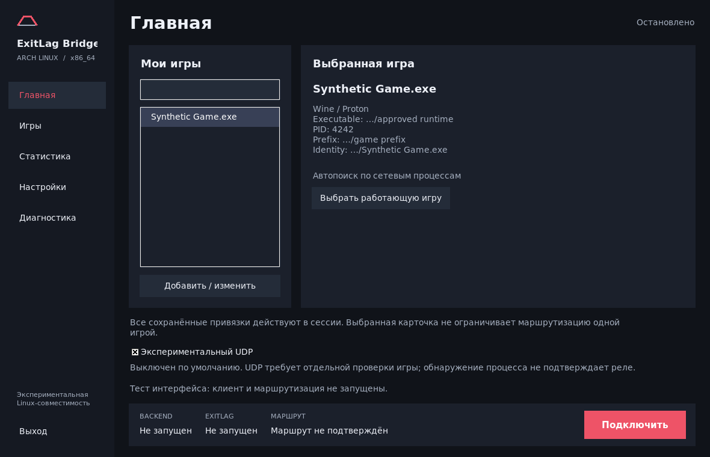

# Desktop-интерфейс ExitLag Bridge

Целевая платформа — Arch Linux x86_64. Используется существующий Tkinter/ttk,
без новых runtime GUI-зависимостей. Окно по умолчанию широкое; стартовая высота
учитывает экран, минимальный размер — 1040×640. Тёмная тема, простая графика
Bridge и контрастная кнопка принадлежат проекту. Компоновка ориентируется на
сценарий классического ExitLag, но не копирует его изображения, тексты или
брендинг и не заявляет идентичность официальному клиенту.



Это настоящий Tk/Xvfb screenshot с synthetic process fixture: официальный
клиент, реле и игра на нём не запущены. Продукт не содержит демонстрационных игр.

## Навигация

- **Главная:** сохранённые игры, поиск, карточка executable/PID/prefix и режим UDP.
- **Игры:** реальные сетевые процессы текущего пользователя, поиск по названию,
  PID и Steam AppID, подробности и переход к проверенному добавлению привязки.
- **Статистика:** время текущей сессии, количество сохранённых привязок, возраст
  снимка и число уникальных socket inode в нём. Это наблюдения интерфейса.
  Ping, потери, jitter и объём переданного трафика помечены «Не измеряется»;
  графики не создаются.
- **Настройки:** переход на официальный сайт и выбор оригинального Windows
  installer. Аккаунт и подписка используются в официальном клиенте.
- **Диагностика:** локальная системная сводка, доступные logs и копирование
  текста с маскировкой. Повышение прав для просмотра логов не запрашивается.

Постоянная нижняя панель показывает backend, клиент и маршрут отдельно. Одна
кнопка **«Подключить» / «Остановить»** управляет сессией. Остановка Wine и ожидание
supervisor выполняются в worker: окно остаётся отзывчивым. При неподтверждённом
завершении сохраняется lock и возможность повторить остановку; новая сессия
не запускается поверх старой, lease повторно не создаётся.

## Статусы и границы доказательств

| Надпись | Что она означает |
| --- | --- |
| Остановлено | У интерфейса нет запущенной сессии |
| Запуск | Начат запуск supervisor/ожидается клиент |
| Клиент запущен | Передан запуск официального клиента через Wine; вход в аккаунт не подтверждается этим статусом |
| Остановка | Отозван lease; UI ждёт завершения фоновой операции |
| Ошибка | Сбой setup/операции или завершение не подтверждено; подробности доступны в UI |
| Backend: Supervisor запущен | Наблюдается процесс supervisor; это не проверка здоровья data plane |
| Backend: Готовность получена | Наблюдался существующий readiness marker; это не постоянная health check |
| Маршрут не подтверждён | GUI не получил независимого подтверждения реального маршрута |

У текущего backend нет отдельного авторитетного канала подтверждения маршрута
для GUI. Поэтому **«Маршрут подтверждён» не показывается**. Процесс клиента,
наличие токена, callbacks и строки логов не превращаются в подтверждение relay
traffic. Выбор серверов и применение маршрута остаются в официальном ExitLag.

## Выбор игры

Запустите игру и сетевую сессию, откройте **«Игры» → «Обновить»**. Выберите
процесс, затем **«Добавить выбранный процесс»**. Откроется существующий picker:
повторно выберите/проверьте process и Windows image, добавьте запись и сохраните.
Launcher/wineserver и неоднозначные images сопровождаются предупреждениями.
Имя и AppID служат поисковыми подсказками, а не основанием авторизации.

**«Добавить / изменить»** открывает список привязок с добавлением, изменением
и удалением. Правки остаются черновиком до Save. Сохраняются комментарии,
проверки UID/generation/socket/image, private atomic save и защита от изменения
файла другим окном. Для ручного Advanced editor требуется явное действие;
его локально редактируемый текст содержит реальные configuration paths.

В обычных карточках отображаются только basenames с маскированными путями.
PID и AppID показываются, когда они наблюдаются в текущем снимке. AppID не
добавляется к map выдуманным значением. Каталога всех установленных Steam-игр
нет: список содержит доступные процессы с сетевыми сокетами.

**Все сохранённые mappings действуют для сессии.** Выбранная карточка не
ограничивает routing одним процессом; изменить эту семантику только интерфейсом
небезопасно. Подробности и prefix scope: [выбор игры](game-selection.md).

## Экспериментальный UDP

Выключен по умолчанию. Переключатель доступен после настройки клиента и
сохранения игры, до запуска сессии. Во время запуска/работы/остановки он
заблокирован. Проверка конкретной игры обязательна; ограничения описаны в
[UDP contract](udp-multi.md). Кнопка в Bridge не заменяет применение route в ExitLag.

## Диагностика и приватность

Читаются только известные `client.log` и установленный backend log. Root-owned
backend log может быть недоступен обычному пользователю — UI сообщает это
вместо обращения к pkexec. Чтение ограничено, symlink/hardlink/FIFO и неверные
owner/permissions отвергаются. Token files не читаются.

Перед показом и копированием скрываются secret-bearing строки, типичные
credential keys, полные POSIX/Windows paths, адреса и длинные идентификаторы.
Маскировка намеренно консервативна и может скрыть полезную часть строки.
Если bounded tail начинается внутри записи, начало отбрасывается до пустой
строки: иначе многострочный секрет мог бы лишиться имени поля и попасть в UI.
Это не разрешение публиковать необработанные логи или captures.

## Сборка и проверки интерфейса

Обновление Git checkout не обновляет установленную программу. Используйте
[инструкцию сборки](arch-linux.md); текущий development installer — `0.4.0+arch.2`.

Настроенные UI/build checks:

```sh
python3 tests/test_linux_launcher.py
python3 tests/test_game_picker.py
python3 tests/gui-picker-smoke.py
python3 tests/test_linux_packaging.py
# В X display, с собранным program tree:
python3 tests/test_desktop_ui.py /path/to/program
```

Для screenshots существующий Tk runner принимает `EXL_DASHBOARD_PREVIEW` и
`EXL_GUI_PREVIEW`. Preview требует Pillow и Unicode fonts; это зависимости
разработки, а не launcher. На Arch используйте системные Python/Tk и
`xorg-server-xvfb`, `ttf-dejavu`. Cloud custom Tk9 без Xft видит только bitmap
fonts и не годится для русского preview; опубликованные изображения сняты
системным Python/Tk8.6 с корректной кириллицей.

Результаты и ограничения: [отчёт UI-итерации](audit/DESKTOP_UI_ITERATION.md).
