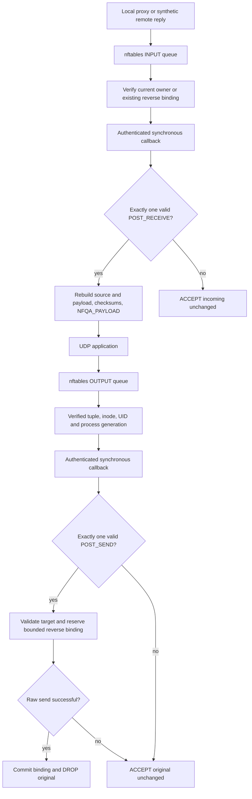

# Экспериментальный multi-endpoint UDP на Arch Linux

Целевая платформа — Arch Linux x86_64. Этот режим расширяет прежний
single-endpoint IPv4 experiment, сохраняя его отдельные runner и tests.
Новый режим включается явно и проверен с локальным **синтетическим**
callback provider. Совместимость с коммерческим клиентом, конкретным реле
ExitLag и игровым процессом требует отдельной проверки.

## Включение через desktop

1. Установить актуальную собранную версию проекта, настроить оригинальный
   клиент ExitLag и добавить игру через **Add / manage games**.
2. Перед запуском отметить **Experimental UDP**. По умолчанию включён TCP.
3. Нажать **Launch ExitLag**, выбрать игру и применить маршрут в официальном
   клиенте. Авторизация и выбор реле остаются в нём.
4. Завершать сессию кнопкой **Stop routing** перед изменением mappings или режима.

Список слева показывает сохранённые mappings и детали выбранной игры.
Выбор строки **не ограничивает** сессию этой одной игрой: helper использует
все проверенные mappings. Статус **Relay traffic: Not verified** не меняется
на основании запуска клиента или обнаружения процесса. GUI не измеряет ping
до реле и не подтверждает gameplay.

Флаг режима передаётся защищённому установленному supervisor как `--udp`.
Он выбирает фиксированный `backend/run-udp-multi.sh`, проверяет владельца
сессии и map, формирует environment без наследования routing overrides и
оставляет коммерческий клиент непривилегированным. Проверки source/package
fixtures не являются публикацией готового installer с Wine payloads.

## Поток пакета



Это не UDP DNAT через TCP maps. Outgoing packet пересоздаётся с фактическим
local address/port приложения, posted remote и posted payload. Исходный packet
удаляется только после успешного raw `sendto`. Incoming replacement сохраняет
local endpoint, восстанавливает source из проверенного `POST_RECEIVE` и
пересчитывает IP/UDP checksums. Для connected UDP это позволяет сохранить
исходный application-visible peer.

Фиксированный raw mark `0x584c0001` предотвращает повторную постановку
пересозданной копии в очередь. `SO_PRIORITY` копируется из исходного packet.
Это не доказательство совместимости со всеми policy-routing/VPN/QoS схемами:
raw socket принадлежит привилегированному helper, а mark зарезервирован.
Исходные UDP packets с ненулевым fwmark в новом режиме остаются без изменения.

## Attribution и состояние

- Перед использованием endpoint выполняется свежий lookup `/proc/net/udp`
  или `udp6` по фактическому local/remote tuple. Совместимые разные inodes
  дают ambiguity и отказ от изменения packet.
- Endpoint связан с family, socket inode, PID, UID, process start time и
  текущей authenticated shim session. Владение fd и identity перепроверяются
  после callback. При загруженной map активный multi-mode требует явного
  совпадения mapping; произвольный `.exe` в argv доказательством не служит.
- Максимум 2048 endpoints и 16 reverse peers на endpoint. Активные peers не
  вытесняются ради нового назначения; исчерпание ёмкости оставляет original
  packet без изменения. Binding создаётся только после успешного raw send.
- Reverse binding содержит фактический local endpoint, original remote и
  posted remote. Неоднозначное перенаправление разных connected sockets,
  использующих один local port, на одинаковый relay tuple отклоняется.
  Один unconnected socket может иметь несколько original remotes, если
  callback корректно восстанавливает source каждого ответа.
- Peer expiration — 60 секунд idle. Endpoint удаляется после 60 секунд idle
  либо при проверке закрытого socket/процесса после 2 секунд idle. Проверка
  reaper выполняется примерно раз в секунду, без realtime гарантии.
- Disconnect или новая authenticated session сбрасывают endpoint state и
  bindings. Свежие IDs получают независимое случайное начальное значение;
  это не session token. При следующем datagram сначала идут lifecycle events.

Проверки `/proc` не делают все syscalls атомарными. Shared fd может
принадлежать нескольким процессам; действующая PID-selection policy остаётся
ограничением. Prefix mapping подтверждает scope и loader, но не предоставляет
kernel attestation Windows image. Эти границы нельзя скрывать за названием игры.

## Поддержанный callback contract и ограничения

Native daemon действует только на один действительно полученный, полностью
валидный `POST_SEND` или `POST_RECEIVE`, совпадающий с текущими tag, endpoint,
direction и session. Reply summary сам по себе не разрешает перенаправление.
Changed non-loopback outgoing target требует отдельного UDP разрешения;
установленный runner задаёт его явно, не расширяя TCP redirect policy.

Shim хранит callback context в Windows TLS, проверяет session при отправке и
использует отдельные receive/owner-table buffers для каждого IPC worker. Асинхронные posts
вне активного callback, неверный endpoint/direction, malformed/duplicate posts,
неподдержанные options и nonzero post status не применяются. Unsupported endpoint
controls, включая flow-control, блокируют активную доставку до удаления endpoint
или новой сессии.

Остаются ограничения:

- Только **синхронные** callbacks; общая асинхронная модель Windows SDK не
  реализована. Полный stop/join всех shim workers при `nf_free` ещё не сделан;
  старые workers могут мешать availability новой сессии. TLS/session checks
  не являются доказательством полного исправления lifecycle.
- `udpConnectRequest` mutation remote наблюдается, но сама по себе не
  перенаправляет packets; действует проверенный datagram POST. Proprietary
  remote-rule layout не расширяется выдуманным IPv6 форматом.
- IPv4 и IPv6 без IP fragments, IPv4 options, IPv6 extension headers,
  jumbograms и GSO. Scoped/link-local IPv6 и mapped IPv6 wire endpoints не
  поддерживаются. Для IPv4 lookup IPv6 ANY bind без доказанного V6ONLY
  консервативно считается неоднозначным.
- Некорректные входящие checksums, incomplete NFQUEUE copies и входящий
  `CSUMNOTREADY` не преобразуются в валидные packets. Исходящий checksum
  может ещё ожидать offload; при пересборке вычисляется новый checksum.
- Input NFQUEUE replacement ограничен 65531 bytes packet payload из-за NLA
  length. Более крупный packet не обрезается ради применения callback.
- Fail-open означает отсутствие намеренной модификации original packet.
  Оно не гарантирует доставку уже принятого relay packet игре, которая
  ожидает original source, или отсутствие потерь при crash/queue overflow.
- Throughput, дополнительная latency/jitter, CPU и saturation пока не
  измерены. На каждом datagram есть `/proc` lookup и синхронный RPC;
  ограниченная память не означает подтверждённую производительность.

## Проверка

В Arch development environment:

```sh
sudo pacman -S --needed base-devel clang lld llvm libmnl nftables iproute2 python tk xorg-server-xvfb ttf-dejavu shellcheck cppcheck
bash tests/run-cloud.sh --sanitizers
make -C backend
bash tests/run-isolated.sh
```

L1 запускается без ExitLag account и без network privileges. L2 wrapper
создаёт отдельные user/network/PID/mount namespaces и временный `/run`;
без нужных kernel capabilities результат — **SKIP**, а не PASS. Не запускать
NFQUEUE tests непосредственно на host firewall в обход wrapper.
`test-udp-multi.py` проверяет isolation до sockets/subprocesses/firewall.

63 выполненных synthetic probes проверили разные процессы, параллельные
endpoints, dynamic ports, remote/payload rewrite в обе стороны, нулевые
datagrams, source semantics, IPv4/IPv6, обычные loopback UDP proxies,
malformed callback cases, collision, port reuse, session reset, timeout,
nonzero-fwmark fail-open и сохранение 32-bit SO_PRIORITY.
Число probes не является числом поддержанных игр или benchmark.
Подробности и ограничения evidence: [отчёт итерации](audit/UDP_INTEGRATION_ITERATION.md).

L3 требует оригинального клиента, действующей подписки, доступного реле и
игры на Linux host. Для каждой игры отдельно фиксируются DETECTED, INSPECTED,
REDIRECT REQUESTED, REDIRECT APPLIED, RELAY TRAFFIC VERIFIED и GAMEPLAY VERIFIED.
В этой итерации live ExitLag, PEAK и gameplay — **NOT TESTED**.
